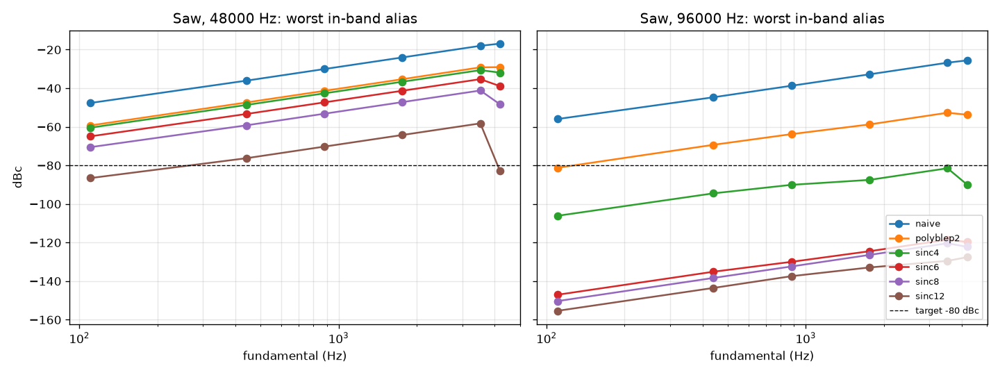

# Oscillator anti-aliasing (M2a decision, ADR 0001 D3)

| | |
|---|---|
| **Decision** | `SincBlep<6>`: tabulated Kaiser-windowed-sinc BLEP/BLAMP, half-span 6 samples, used at AUREL's 88.2–96 kHz internal voice rate |
| **Date** | 2026-11-22 |
| **Also confirms** | D4: voices must run at ≥ 88.2 kHz internally; no kernel meets the target at 1× 44.1/48 kHz |
| **Data** | [m2a-aliasing.csv](m2a-aliasing.csv) (576 measurements); reproduce with `Scripts/analysis/oscillator_aliasing.py` |

## Method

**Oscillator** (`Source/DSP/Oscillators/BandlimitedOscillator.h`): the naive waveform is generated per sample. Each discontinuity (saw/pulse steps) or corner (triangle peaks) is located with sub-sample precision from the phase, and a kernel correction is overlap-added into a ring buffer around it. Linear-phase kernels need look-ahead, so the output is delayed by the kernel half-span.

**Kernels compared** (`Source/DSP/Oscillators/BlepKernels.h`):

| Kernel | Description |
|---|---|
| naive | no correction (reference) |
| polyblep2 | 2-point polynomial BLEP + polyBLAMP (step convolved with a linear B-spline) |
| sinc4 / 6 / 8 / 12 | integral of a Kaiser-windowed sinc (β = 9, cutoff = Nyquist) spanning 2H samples; tables at 1024 phases/sample, linear interpolation |

**Metric** (`aurel_analysis.metrics.alias_analysis`, validated against a planted −70 dBc alias to ±0.05 dB): worst single alias component landing in **20 Hz–20 kHz**, relative to the fundamental. Content between 20 kHz and Nyquist is ignored because AUREL's decimator removes it. Harmonic error = max |level error| of harmonics ≤ 20 kHz against the ideal Fourier series.

**Matrix:** saw, pulse 50 %, pulse 10 %, triangle × A2, A4, A5, A6, A7, C8 (110–4186 Hz) × 48 / 88.2 / 96 / 192 kHz. One-second renders, Kaiser β = 24 analysis window.

**Targets** (fixed before measuring): worst alias ≤ −80 dBc up to C8 at the internal rates; harmonic error ≤ 1 dB to 20 kHz.

## Results: worst case over all notes (dBc)

### 96 kHz (2× of 48 kHz host)

| kernel | saw | pulse 50 % | pulse 10 % | triangle | harm. err ≤ 20 kHz |
|---|---|---|---|---|---|
| naive | −25.6 | −25.6 | −17.7 | −51.2 | 0.07 dB |
| polyblep2 | −52.7 | −53.7 | −47.1 | −79.3 | **1.25 dB** |
| sinc4 | −81.5 | −89.9 | −75.9 | −115.5 | 0.03 dB |
| **sinc6** | **−118.5** | **−118.4** | **−110.1** | **−145.2** | **0.00 dB** |
| sinc8 | −120.4 | −123.9 | −114.8 | −150.3 | 0.00 dB |
| sinc12 | −127.6 | −127.6 | −122.6 | −153.0 | 0.00 dB |

### 88.2 kHz (2× of 44.1 kHz host)

| kernel | saw | pulse 50 % | pulse 10 % | triangle | harm. err ≤ 20 kHz |
|---|---|---|---|---|---|
| naive | −24.6 | −24.6 | −16.2 | −49.2 | 0.82 dB |
| polyblep2 | −50.5 | −50.5 | −42.1 | −75.1 | **1.48 dB** |
| sinc4 | −77.0 | −77.0 | **−70.9** | −103.9 | 0.06 dB |
| **sinc6** | **−116.9** | **−118.5** | **−111.3** | **−144.8** | **0.00 dB** |
| sinc8 | −118.0 | −118.0 | −109.6 | −142.6 | 0.00 dB |
| sinc12 | −125.3 | −127.4 | −119.1 | −152.2 | 0.00 dB |

### 48 kHz (1×, *not* used by AUREL; shows why oversampling is required)

| kernel | saw | pulse 50 % | pulse 10 % | triangle |
|---|---|---|---|---|
| polyblep2 | −29.1 | −29.1 | −20.7 | −46.0 |
| sinc12 | −58.2 | −82.7 | −52.6 | −99.6 |

At 192 kHz every sinc kernel is below −113 dBc.

## CPU (Release, i5-11400H, 96 kHz, ns per sample per oscillator)

| kernel | saw 440 Hz | saw 3.5 kHz | pulse 3.5 kHz | triangle 3.5 kHz |
|---|---|---|---|---|
| naive | 2.7 | 3.1 | 3.1 | 3.5 |
| polyblep2 | 6.8 | 7.5 | 7.5 | 8.2 |
| sinc4 | 6.4 | 9.0 | 11.4 | 12.0 |
| **sinc6** | **7.1** | **11.3** | **15.2** | **16.0** |
| sinc8 | 7.3 | 12.7 | 17.3 | 16.5 |
| sinc12 | 7.0 | 13.9 | 20.8 | 24.0 |

The cost scales with discontinuities per second, so high notes cost more. At low/mid pitch, polyblep2 is not cheaper than the sinc kernels: the per-sample ring-buffer work dominates.

**Budget estimate (assumption, verified in M5):** 32 voices × 4 oscillators (3 + sub) × 96 kHz × 8–16 ns ≈ 10–20 % of one core for oscillators alone, worst case at high pitch.

## Decision and reasoning

1. **polyblep2 is rejected.** At the internal rate it reaches only −42 to −53 dBc on saw/pulse (target −80) and dulls the top octave by 1.25–1.48 dB. It also costs about the same as sinc6 at typical pitches.
2. **sinc4 is rejected.** It fails the target for narrow pulses at 88.2 kHz (−70.9 dBc).
3. **sinc6 is chosen.** It is ≥ 30 dB better than the target everywhere at the internal rates (worst −110.1 dBc, narrow pulse), and harmonics are exact to 20 kHz. sinc8/12 gain ≤ 9 dB below an already inaudible level, for 10–50 % more CPU at high notes.
4. **2× internal rate is confirmed as necessary (D4).** At 1× 48 kHz even sinc12 only reaches −52.6 dBc. Oversampling is what makes short kernels sufficient: alias folding into the audible band now needs energy above fs − 20 kHz (≥ 68 kHz), where the kernel's stopband is deep.

**Latency:** 6 samples at the internal rate (68 µs at 88.2 kHz, before decimation). This is not audible and not reported to the host as plugin latency.

**Headroom:** a band-limited step overshoots by ~8.95 % of the jump (Gibbs). For ±1 saw/pulse, peaks reach ≈ 1.18. The mixer's gain staging must budget for this.

## Guards

* `Tests/Unit/DSP/OscillatorTests.cpp`: kernel shape/symmetry; output identical to the naive waveform away from discontinuities (corrections are local and correctly timed); DC; pulse-width mean; bounds; no allocation.
* `Scripts/analysis/tests/test_oscillator_aliasing.py`: sinc6 must stay below **−100 dBc** (10 dB margin) with harmonic error < 0.1 dB at 88.2/96 kHz, and the naive saw must still register as aliased (harness sanity).

## Not yet covered (M2b)

Hard sync, through-zero FM, waveform-switch correction, sub-oscillator, noise, mixer. Each discontinuity they introduce goes through the same kernel, and each gets its own measurement.
